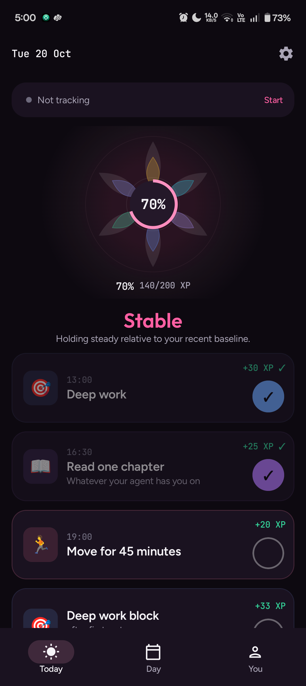
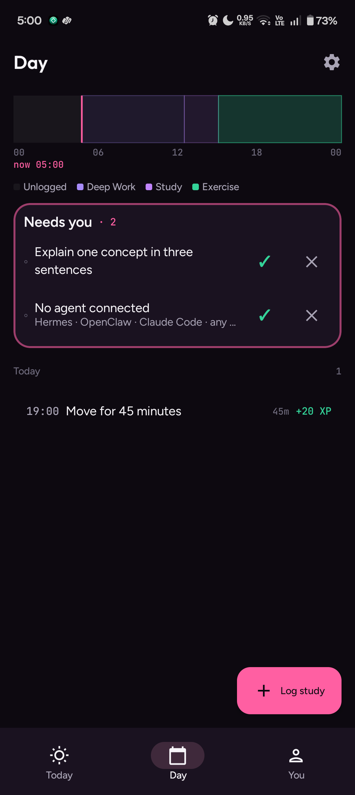
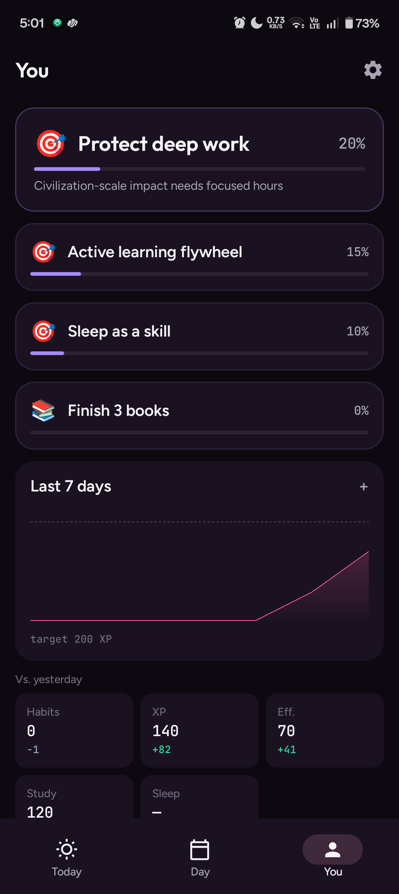

<div align="center">


# Life OS

### Let AI agent manage your **life** · **habits** · **health** · **study** · **goals** · **sleep**

Your agent designs the system and keeps it up to date. You just tap to complete.

[**🌐 Website**](https://entangledquantum.github.io/Life_OS/) &nbsp;·&nbsp;
[**📱 Android app**](https://github.com/EntangledQuantum/Life_OS/releases) &nbsp;·&nbsp;
[**📖 Docs**](https://entangledquantum.github.io/Life_OS/docs/)

<sub>Runs on your machine · no account · Node 22.5+ · SQLite · MIT</sub>

</div>

<br />


<br />

<!--
  Goals earn their own shot now that they have rungs: the pips under each one
  are a rarity ladder, and which of them are lit is the whole story.
-->


<table>
  <tr>
    <td width="33%" valign="top">
      
    </td>
    <td width="33%" valign="top">
      
    </td>
    <td width="33%" valign="top">
      
    </td>
  </tr>
</table>

<br />

## Set it up

Paste this at any agent that can read a URL and run commands:

```
Fetch https://raw.githubusercontent.com/EntangledQuantum/Life_OS/master/docs/AGENT_SETUP.md and set Life OS up for me
```

It will install it, run it as a service, connect over MCP, interview you about
your actual day, and schedule its own nightly check-in. Prefer to do it
yourself? [`docs/AGENT_SETUP.md`](docs/AGENT_SETUP.md) is readable by humans
too, and `pnpm setup && pnpm dev` is the short version.

<br />

## What it is, and why you'd want it

Most habit apps assume the hard part is *doing* the thing. For a lot of people
it isn't. The hard part is **designing and maintaining the system** — deciding
what to track, noticing a habit has quietly died, re-slicing the day when
something stops working, remembering to review any of it. That is the part that
collapses first, and once it does, the app becomes another thing you're failing
at.

So Life OS splits the job in two:

- **You do the doing.** Tap to complete. That is the entire interface.
- **Your agent does the designing.** It creates the habits, schedules the day,
  writes the goals, watches what actually happened, and adjusts.

Everything lives in one SQLite file on your own machine. There is no account,
no cloud, no sync, and no way for anyone to see your data — including us.

Two nouns, and that's the whole model:

- **Habits** — recur, scored daily.
- **Tasks** — everything else: scheduled work, reminders, reviews, study
  blocks, the cards on your front page. One kind of thing with optional parts.

A few deliberate refusals: no levels, no ranks, no leaderboards, no streak
guilt, and nothing on the screen ever turns red because you had a bad day.
XP measures today against today's target and nothing else.

<br />

## What it looks like in use

**Your agent notices a pattern.**
> "You've skipped the 07:00 reading block four days running. Moving it to 21:30
> — you finished it every time it was there last month."

**You're studying something.**
Your agent schedules a study task with the chapter, the instructions, and links
to the PDF and a video. All of it shows up on your phone at the right time. You
read it, you tap done, the minutes are recorded.

**Something happens on the agent's side.**
It finishes processing a book you read, increments `books_read`, and the goal
you set in January — *read 20 books* — ticks forward on its own. When it
completes, the dashboard plays the celebration. The goal isn't finished until
you've seen it.

**You want to be told when something is done.**
Your agent subscribes to a webhook and hears about every completion the moment
it happens, instead of asking every five minutes.

<br />

## Contributing

Issues and PRs welcome. It is a pnpm workspace: `apps/api` (Hono),
`apps/web` (React) and `packages/{db,shared,mcp}`, plus
`mobile-frontend/native-android` — the Android client, Kotlin and Jetpack
Compose, built with the Android SDK command-line tools and Gradle. It is
deliberately isolated: it is not in the pnpm workspace, it must never import
from `apps/*` or `packages/*`, and its only contact with the rest of the repo
is HTTP to the API. `mobile-frontend/app` is the retired Expo client, kept
until the native one has been in daily use for a while.

```bash
pnpm install
pnpm setup      # .env, database, seed data
pnpm dev        # api + web
pnpm test       # every package
pnpm typecheck
```

Before opening a PR: `pnpm typecheck && pnpm test`, and in
`mobile-frontend/native-android`, `./gradlew assembleDebug assembleRelease test
lint` if you touched the Android app. Build the **release** variant too, not
just debug: Android permits cleartext HTTP in debug builds automatically, so a
release-only networking failure is invisible until someone installs an APK.
Database changes go in `packages/db/src/migrations.ts` as a **new numbered
migration** — never edit a shipped one.

Full docs, the API reference and the agent skill are on the
[website](https://entangledquantum.github.io/Life_OS/) and under
[`docs/`](docs/).

<br />

## License

MIT — do what you like with it.

<div align="center">
<br />
<sub>Built for a brain that does the work but hates maintaining the system.</sub>
</div>
